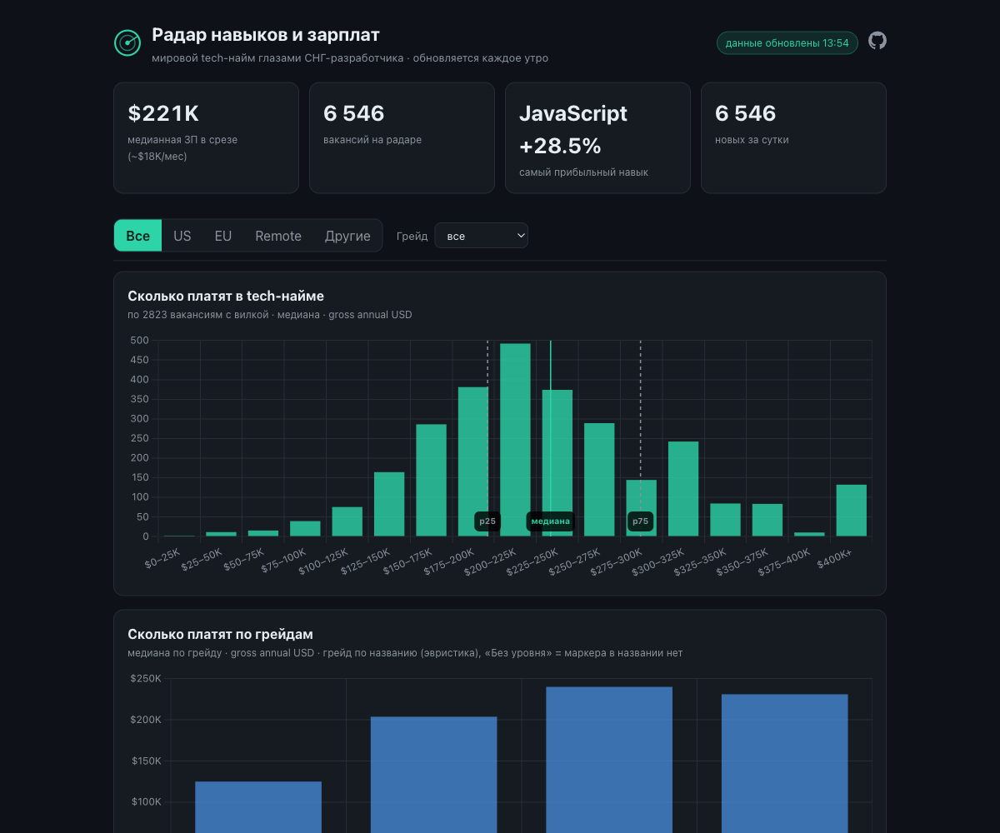
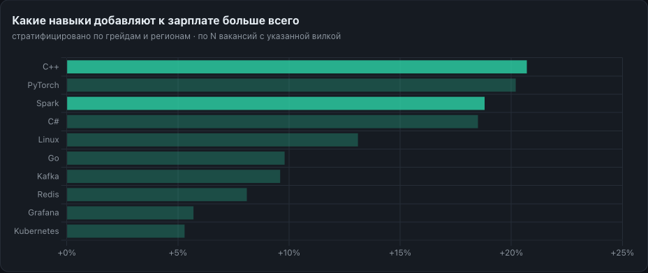
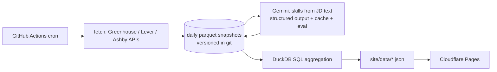

# tech-salary-radar

**Self-updating dashboard of the global tech job market — what skills companies hire for and how much they pay. Rebuilds itself every morning for $0/month.**

[](https://github.com/midat-fx/tech-salary-radar/actions/workflows/pipeline.yml)
[](https://github.com/midat-fx/tech-salary-radar/actions/workflows/ci.yml)

[](.github/workflows/llm-eval.yml)

[](LICENSE)

**→ Live dashboard (RU): https://tech-salary-radar.pages.dev**




## What it does

- Pulls open engineering / data / product-tech roles every morning from the **public career-board APIs** (ATS) of ~300 tech companies — Greenhouse, Lever, Ashby.
- Normalizes pay to **annual gross USD**, tags region and seniority, and uses an LLM to extract the technology stack from each job description.
- Shows medians by grade & region, the most in-demand skills, and — the flagship — **which skills add the most to salary**, stratified to control for grade and region confounding.

The dashboard is in Russian, aimed at CIS developers: *what to learn and how much it pays.*

## Architecture



## Engineering highlights

- **Multi-source ETL** over three ATS APIs with a single normalized schema, polite crawling (one request per board, backoff, dead-board tolerance).
- **LLM structured output** (Gemini, enum-constrained JSON) to extract a canonical skill catalog from free-text JDs — **cached** (never re-extracted), with a **two-layer quality gate**: a deterministic linter proves every eval label is literally present in the text, then a live micro-F1 ≥ 0.75 gate runs in CI (currently 0.86).
- **Guardrails against silent data corruption:** a volume guard refuses to commit a day where a source collapsed vs its 7-day median, plausibility guards reject benefit/funding amounts parsed as pay, and a circuit breaker skips a whole ATS after repeated failures.
- **Parquet history versioned in git** — the whole dataset is downloadable and recomputable; no database to run.
- **DuckDB** analytics straight over the parquet partitions.
- **$0/month infrastructure:**

  | piece | service | tier |
  |---|---|---|
  | scheduling / compute | GitHub Actions | free |
  | hosting | Cloudflare Pages | free |
  | skill extraction | Gemini flash-lite | free tier |
  | storage | git (parquet) | free |

## Data & methodology

- **Salary** is annual **gross** USD. Intervals are annualized (hourly ×2080, weekly ×52, monthly ×12); non-USD is converted daily. Midpoint = `COALESCE((min+max)/2, min, max)`. Rows outside $10k–$1.5M are dropped as parse errors.
- Only jobs **with a stated salary band** feed the salary charts — labeled *"по N вакансий с указанной вилкой."* Salary bands are dense on Ashby and sparse elsewhere (US pay-transparency), so the current base skews US; the EU stratum fills in as data grows.
- **Skill premium** is stratified by **grade × region** to avoid confounding a skill's value with where/at what level it appears. Only jobs the extractor has actually labelled take part — an unlabelled job is not evidence that a skill is absent. Each premium ships a **stratified-bootstrap 95% CI**; bars whose interval crosses zero are dimmed on the dashboard as statistically insignificant.
- **Management roles** (Manager/Director/VP/…) are excluded from all salary statistics.
- **Seniority** is a heuristic from the job title (`Senior`, `Staff`, `Engineer II`…); roles with no level marker are a separate `Без уровня` bucket, never merged into mid. Ambiguous level codes (`L5`, `IC3`, `Engineer I/III`) stay unspecified rather than being guessed.
- **Survivorship bias:** ATS boards expose only currently-open roles, so historical "new by publish date" reflects only still-open jobs.
- **Known limits, stated plainly:** salary bands are dense on Ashby and sparse on Greenhouse/Lever, so the salary base skews US; skill coverage is the labelled subset (the dashboard prints the exact %); a job description often lists the *company* stack rather than the role's, which inflates common skills.
- **Download the data:**
  ```bash
  duckdb -c "SELECT seniority, median(salary_mid_usd) FROM read_parquet('data/snapshots/*/part.parquet') WHERE has_salary AND NOT is_management GROUP BY 1"
  ```

## Deliberate limits

These are decisions, not gaps. Each one is written up in [`docs/adr/`](docs/adr/)
with what it costs.

- **No postings without a stated range enter the salary statistics** — and that
  biases the base towards the United States, where pay-transparency law is why a
  range is present at all. About one posting in five carries one.
- **No management roles in the pay figures at all.** Manager, director, VP, head
  and chief titles are removed rather than bucketed: their pay is a different
  distribution, and mixing it moves the senior median without any sample
  changing.
- **No database.** Parquet in git and DuckDB over it. The history is the commit
  log, which is what makes a chart reproducible from a commit.
- **No incremental recomputation.** A day is aggregated whole, every time.
- **No sources beyond the three ATSs.** Aggregators republish the same postings
  with different semantics and no way to tell one company's opening from
  another's copy of it.
- **No skill detection without an LLM.** A keyword dictionary finds "Python" in
  "not a Python role" and misses "питон"; the eval set is what keeps the model
  honest instead.
- **No historical currency conversion.** Every figure uses the rate on its
  snapshot day, so a European salary from July and one from August are not
  strictly comparable.
- **No deletion from history.** A posting taken down stays in the snapshot of
  the day it was open.
- **No retroactive edits to past aggregates.** A day the guards refused is a gap
  in the series, and the gap is the record.
- **No personal data.** Recruiter names, contacts and applicant-facing fields
  are never stored.
- **No net-of-tax figures.** Everything is gross. A posting that quotes net is
  read as gross and therefore understates; detecting it would need a
  jurisdiction and a tax model that a job advert does not contain.
- **Timezone anchoring is read, not inferred.** "Remote (CET)" is a European pay
  market and "Remote" alone is unknown; no city is mapped to a zone.

## Run locally

```bash
pip install -e ".[dev]"
python -m etl.cli run --skip-llm    # fetch boards -> parquet (skip the LLM step)
python -m etl.cli aggregate         # parquet -> site/data/*.json
python -m http.server -d site 8080  # open http://localhost:8080
```

## Roadmap

- Remote-first slice via Remotive / Arbeitnow.
- More ATS (Workday, SmartRecruiters, Recruitee) and a broader skill catalog (Rust, Scala, Ruby, Swift, dbt, Snowflake).
- Product & design role slices; per-country breakdowns; light theme; EN dashboard.

## License

MIT © Midat Faizov
